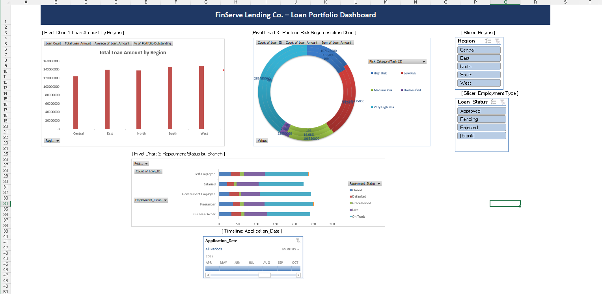

# FinServe Loan Portfolio Analysis

## Project Overview
This project analyzes a fictional lending company's loan portfolio using Microsoft Excel. The objective is to examine loan exposure, borrower risk categories, repayment performance, and regional differences to support management reporting.
## Dashboard Preview

---
## Business Problem
FinServe Lending Co. wants to understand its loan portfolio more clearly, identify potential repayment risks, and compare loan exposure across regions and branches.

## Tools Used
- Microsoft Excel
- Data Cleaning and Standardization
- Excel Formulas and Calculated Columns
- Pivot Tables and Pivot Charts
- Dashboard Visualization

## Work Completed
- Cleaned and standardized loan-related data.
- Prepared calculated columns for loan analysis.
- Classified borrowers into credit risk categories.
- Analyzed loan exposure across regions and branches.
- Examined repayment performance by relevant categories.
- Created pivot tables, charts, and a management dashboard.

## Project Files
- [Excel Solution Workbook](FinServe_Solution_Alok_Pandey.xlsx)
- [Raw Loan Portfolio Dataset](FinServe_Loan_Portfolio_Dataset.xlsx)
- [Original Case Study](FinServe_Case_Study.pdf)

## Business Analysis Areas
- Loan exposure by region
- Risk category distribution
- Repayment performance by employment type
- Branch-level loan exposure
- Monthly loan application trends

## Key Learning
This project provided practical experience in preparing structured data, conducting Excel-based financial analysis, creating visual summaries, and presenting information through a management dashboard.

## Data Note
FinServe Lending Co. is a fictional case study. The analysis is based on the dataset and assumptions provided for the exercise.
